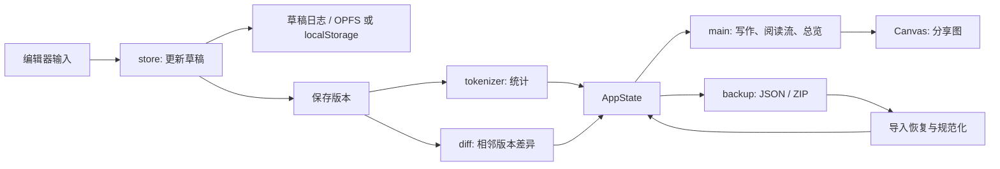

# 逐字项目代码分析报告

> 基于当前仓库源码的静态分析；项目版本为 `0.3.1`。

## 1. 项目概况

逐字是一个本地优先的每日写作单页应用。用户可以按日期创建多篇练习，保存不可覆盖的文本版本，查看相邻版本的 token 级变化，并通过阅读流和总览回顾写作记录。应用还提供 Markdown、图片、JSON、ZIP 导出与 ZIP/JSON 恢复，以及安装后离线使用的 PWA 能力。

项目没有应用服务器或数据库服务。页面由 Vite 构建为静态资源；写作数据保存在当前浏览器、当前 origin 下，优先使用 OPFS，并保留 `localStorage` 兼容快照和草稿恢复日志。页面还向已打开的浏览器上下文暴露只读的 `window.zhuzi` API；这不是 HTTP API。

## 2. 技术栈与目录

| 位置 | 作用 |
| --- | --- |
| `index.html` | 静态 HTML 入口，挂载 `src/main.ts`，声明 PWA manifest。 |
| `src/` | TypeScript 业务逻辑、界面和样式。 |
| `src/assets/` | 页面和分享图使用的明暗主题 SVG 标识。 |
| `public/` | Service Worker、manifest、favicon 等直接发布的资源。 |
| `tests/` | Node 内置测试运行器执行的单元与兼容性测试，另有合成档案夹具。 |
| `scripts/` | 版本一致性检查、性能基线、合成档案生成。 |
| `.github/workflows/quality.yml` | 推送和 PR 的自动质量检查。 |

主要技术是 TypeScript、Vite、原生 DOM/CSS、Canvas、浏览器 OPFS/`localStorage`/Cache API。运行时第三方依赖只有 `jszip`，用于备份 ZIP 的读写；没有前端框架。

## 3. 代码模块

| 模块 | 主要文件 | 职责与关键接口 |
| --- | --- | --- |
| 数据模型 | `src/types.ts` | 定义 `AppState → DailyEntry → Version`，以及 token、统计与 diff 的结构。`DailyEntry` 同时保存草稿和版本数组；每个 `Version` 保存完整正文、统计和相邻版本 diff。 |
| 文本切分与统计 | `src/tokenizer.ts` | `tokenize()` 把汉字、连续拉丁字母、连续数字及标点/符号转为 token；`getTokenStats()` 计算 300 字标尺等统计。空白和未覆盖的文字脚本不计入 token。 |
| 版本差异 | `src/diff.ts` | `diffTexts()`/`diffTokens()` 使用最长公共子序列计算 `KEEP/INSERT/DELETE`；`summarizeDiff()` 统计分类增删；`alignDiffToContent()` 将 diff 对齐到原文，供版本阅读高亮，同时保留换行和空白。 |
| 状态与持久化 | `src/store.ts` | 创建和切换练习、更新草稿、追加版本、清理历史空记录；读取及规范化旧数据；管理 OPFS 升级、写入队列、`localStorage` 兼容快照、草稿日志和存储状态。 |
| 备份格式 | `src/backup.ts` | 使用 JSZip 读写 ZIP；生成保留完整 diff 的数据 JSON，以及用 `diff_summary` 代替逐 token diff 的轻量分析 JSON；导入时按完整数据、旧版完整数据、分析数据的顺序选择。 |
| 写作年与总览计算 | `src/writing-years.ts`、`src/overview-layout.ts` | 以首次写作日起的固定 365 天划分写作年；计算总览导出条形布局、月份标签和非初稿版本的修改总量。 |
| 分享图排版 | `src/share-card-layout.ts`、`src/share-text-layout.ts` | 计算文章分享卡的尺寸和区块位置；按文本测量宽度换行，处理中文标点的行首/行末禁则及空行。 |
| 页面与交互编排 | `src/main.ts` | 生成页面 DOM，绑定编辑、导航、主题、导入导出等事件；渲染写作页、版本链、阅读流和总览；用 Canvas 生成文章图及总览图；注册 Service Worker，安装 `window.zhuzi`。 |
| 视觉与离线资源 | `src/styles.css`、`public/sw.js`、`public/manifest.webmanifest` | 布局和明暗主题；缓存应用壳、构建资源、字体及运行时资源，支持离线访问和版本更新。 |

`src/main.ts` 约 2,830 行，是目前主要的界面控制中心；`src/styles.css` 约 1,600 行。其余业务规则已分散到可独立测试的模块。

## 4. 核心数据流

保存版本时，`store.saveVersion()` 根据当前草稿创建新 `Version`，计算 token 统计和相对于前一版本的 diff，再将版本追加到对应练习。导入分析 JSON 时，`store.normalizeEntry()` 会从相邻版本正文重建缺失的完整 diff。

总览和分享图主要读取版本快照及其派生统计。阅读流按批次展示已保存的练习；总览按写作日聚合练习数、字数、版本数和修改量。主题偏好单独保存在 `localStorage`。

## 5. 测试与工程化

- `tests/` 覆盖 token 规则、diff 及内容对齐、状态迁移和草稿恢复、备份兼容、写作年、分享图和总览布局，以及合成档案生成规则。
- `npm test` 使用 Node 内置测试运行器；`npm run check` 串联版本检查、测试、TypeScript 检查和生产构建。
- CI 使用 Node 22、`npm ci`、`npm run check`，并执行高危级别的 `npm audit`。仓库当前提交的是 `package-lock.json`，因此现有自动化基于 npm。
- `scripts/performance-baseline.mjs` 生成长档案的性能基线；`scripts/generate-synthetic-archives.mjs` 生成不同规模的 ZIP 体验档案。

本报告只进行了源码静态检查，没有安装依赖或运行测试与构建。

## 6. 结构特点与关注点

1. **本地数据链路清晰，但浏览器存储是唯一数据位置。** OPFS 写入之外仍尝试保存 `localStorage` 完整兼容快照；草稿输入在 OPFS 模式下先写小型恢复日志，再延迟写入 OPFS。跨浏览器或清理站点数据时，需要依赖用户导出的备份恢复。
2. **界面逻辑集中。** `main.ts` 同时负责 DOM、事件、聚合计算、Canvas 绘图、导入导出和存储提示。新增视图或修改交互时，较容易扩大单文件改动范围；可优先按视图与导出职责拆分。
3. **diff 算法随文本长度增长较快。** `diffTokens()` 构建二维最长公共子序列表，时间和内存复杂度均约为 `O(m×n)`。长篇正文或大量历史版本的重建与汇总值得持续关注性能基线。
4. **业务计算已有可测试边界。** 文本规则、备份格式、写作年及排版计算已从页面逻辑中抽离，相关测试较完整；现有测试主要验证纯逻辑和存储兼容，浏览器中的整页交互及 Service Worker 离线流程不在这些测试的直接覆盖范围内。
5. **发布版本需多处同步。** `package.json`、`public/sw.js`、README、CHANGELOG 和应用内更新日志各自维护版本信息，`scripts/check-version.mjs` 已提供一致性检查。
