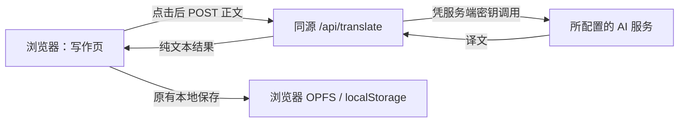

# 写作内容翻译功能详细设计

> 状态：0.4.0 已按首版设计实现；真实 AI 服务联调需要用户自己的密钥，局域网 HTTPS 部署暂缓。依据 [`TRANSLATION_PLAN.md`](./TRANSLATION_PLAN.md)；2026-10-24。

## 1. 已确定的需求

- 用户主动点击后，翻译当前草稿或正在查看的历史版本全文，目标语言为英文。
- 译文忠实、自然、接近日常表达；语境合适时允许少量常见俚语。
- 站点主要供个人在受信任的本地局域网使用，不建立用户账户。
- 可切换 OpenAI、DeepSeek、OpenCode Console 等提供兼容接口的服务。切换通过服务端配置完成，页面不显示密钥。
- 译文只作参考，不写入草稿、版本、统计、备份或分享图。首版只存于当前页面内存，刷新后消失。

## 2. 现状与设计约束

`src/main.ts` 维护 `view`、`detailMode` 和 `selectedVersionId`，写作模式显示 `DailyEntry.draft`，版本模式显示 `Version.content`。`src/store.ts` 把文章保存在浏览器当前 origin 的 OPFS 或 `localStorage`；备份格式由 `src/backup.ts` 管理。`public/sw.js` 只接管 GET 请求。翻译不能改变这些数据结构和写作流程。

**局域网地址影响本地数据能力。** 普通 `http://192.168.x.x` 或 `http://主机名` 通常不属于安全上下文；OPFS 与 Service Worker 要求安全上下文。`http://localhost` 在访问设备自身浏览器中可作为开发例外，但另一台设备通过局域网 IP 访问时不能借用该例外。生产使用应通过受浏览器信任的 HTTPS 地址打开页面；证书需要在实际访问设备上受信任。改用 HTTPS 域名、主机名或端口会改变 origin，已有浏览器档案不会自动出现在新地址，切换前应在旧地址导出 ZIP，在新地址导入验证。

## 3. 架构与部署



生产建议：同一局域网主机上运行静态站点与翻译服务，HTTPS 反向代理统一提供一个 origin，`/api/translate` 转发到仅监听 `127.0.0.1` 的应用服务，其余路径提供 Vite 构建后的 `dist/`。代理只允许局域网访问，不设置公网端口映射。API 进程的密钥只在服务器环境变量或服务器本地受保护的配置中，不进入 Vite 构建、浏览器存储、仓库或日志。局域网内其他设备仍可能请求此接口，因此保留输入限制、简单限流和服务商用量提醒。若局域网并非完全受信任，应另加访问保护；本设计不包含账户系统。

本机开发：`pnpm run dev` 仍绑定 `127.0.0.1`；Vite 开发代理把 `/api` 转到 `pnpm run dev:api` 启动的本机 API 服务，浏览器继续用同源相对路径。构建后可用 `pnpm run start` 在同一地址提供页面和接口。不要把 Vite 开发服务器直接当生产服务，也不要把 `server.allowedHosts` 设为 `true`。局域网 HTTPS 和 OPFS/Service Worker 的实际可用性按需另行验证。

推荐新增文件职责：

| 文件 | 职责 |
| --- | --- |
| `src/translation.ts` | 前端请求、请求状态与正文快照一致性判断；不接触文章持久化。 |
| `src/main.ts` | 放置按钮和译文区域，调用前端模块，响应编辑/切换事件。 |
| `src/styles.css` | 对照阅读布局、移动端、加载和错误状态。 |
| `server/translate.mjs` | 校验请求、调用适配器、统一错误响应；只接收正文。 |
| `server/providers.mjs` | Chat Completions 与 Responses 的请求和响应格式适配。 |
| `server/prompt.mjs` | 固定提示词 v1，供两个适配器共用。 |
| `tests/translation.test.ts`、`tests/translate-api.test.ts` | 快照状态及 API/适配器测试；沿用现有 `tests/*.test.ts` 运行入口。 |

服务端文件名是建议组织方式，可随现有部署工具调整，但前后端边界和接口契约保持一致。服务端不与 `src/store.ts` 共享 `AppState`，不读取浏览器数据。

## 4. 页面交互与状态

### 4.1 位置与内容

在正文区现有 `textarea#editor` / `article#reader` 下方增加翻译操作栏和“参考译文”区域。按钮文案为“翻译成英文”；旁边固定短说明：“点击后将当前正文发送给已配置的 AI 服务，可能产生费用。”历史版本只读状态下也可翻译。译文区域显示本次发送的原文快照和对应英文，桌面双栏、窄屏单栏；原文快照不可编辑，编辑仍在原有编辑器中完成。显示译文时提供“复制英文”和“重新翻译”，可取消进行中的请求。

空白正文时按钮禁用。`navigator.onLine === false` 时提示“翻译需要联网”；该值不能证明服务一定可用，实际网络失败仍按请求错误处理。加载时禁用重复点击。状态变化通过 `aria-live="polite"` 报告，错误用 `role="alert"`；取消、复制按钮可用键盘操作。翻译输出用 `textContent` 和 `white-space: pre-wrap` 显示，不解析为 HTML。

### 4.2 有限状态

| 状态 | 页面行为 | 进入条件 |
| --- | --- | --- |
| `idle` | 只显示按钮和说明 | 初始、切换正文、编辑后清除旧结果、取消完成后 |
| `loading` | 显示原文快照、加载状态和取消按钮 | 用户点击且正文非空 |
| `success` | 显示原文与译文、复制和重新翻译 | 收到有效且仍匹配当前正文的结果 |
| `error` | 显示原文快照、错误和重试按钮 | 当前请求失败且快照仍匹配 |

点击时生成递增的 `requestId`，记录 `entryId`、`mode`、`versionId | null`、`text` 快照和 `AbortController`。选择内容按以下规则：`mode=writing` 时用 `getActiveEntry(state).draft`；`mode=version` 时用当前选择的 `Version.content`，即使该版本是历史日期也允许翻译。发送前要求 `text.trim().length > 0`，但实际发送原始 `text`，保留换行和首尾空白。服务端再次校验。

输入变化、切换练习、切换版本、切换顶层视图、导入档案、存储重新加载和保存版本后的渲染，都调用统一的 `invalidateTranslation()`：中止请求、递增请求序号、清理译文状态。若只是主题变化，不清理译文。响应到达时同时比较 `requestId`、`entryId`、`mode`、`versionId` 和正文全文；任一不匹配就丢弃结果。取消不保证上游停止计费，页面应避免暗示已撤销上游调用。

`renderInputState()` 目前只更新输入统计；翻译状态的清理需在编辑器 `input` 事件中显式调用，不依赖完整 `render()`。翻译区单独渲染，避免对译文组件调用 `innerHTML` 时丢失状态和焦点。视图切换清理策略以首版方案为准：切走即清理，回来需重新点击。

## 5. 前后端接口契约

`POST /api/translate`，同源、`Content-Type: application/json; charset=utf-8`。前端仅发送正文，服务商选择完全由服务端配置控制。

请求示例：

```json
{ "text": "今天下班后，我沿着河边走了一会儿。" }
```

成功响应：HTTP 200，`Cache-Control: no-store`：

```json
{ "translation": "After work today, I took a walk along the river." }
```

失败响应格式：

```json
{ "error": { "code": "UPSTREAM_TIMEOUT", "message": "翻译超时，请稍后重试。" } }
```

| HTTP | `code` | 触发条件与处理 |
| --- | --- | --- |
| 400 | `INVALID_INPUT` | JSON 无效、字段不符、正文空白；前端提示检查正文。 |
| 413 | `INPUT_TOO_LONG` | 超过请求体或正文字数上限；前端提示缩短正文。 |
| 429 | `RATE_LIMITED` | 本地限流或上游限流；提示稍后重试。 |
| 502 | `UPSTREAM_ERROR` | 上游错误、拒绝、响应格式错误或译文为空；允许重试。 |
| 504 | `UPSTREAM_TIMEOUT` | 上游超时；允许重试。 |
| 503 | `SERVICE_UNAVAILABLE` | 缺少服务端配置；提示检查服务配置。 |

初始约束建议：请求体最多 32 KiB，正文最多 12,000 个 Unicode 码点，单请求超时 60 秒，最多 2 个并发调用和每分钟 10 次请求。服务端按实际字节数和码点数分别检查；上限作为服务器常量或环境变量，前端提供相同的预检查以尽早提示。超限错误不得回显正文。所有响应都设置 `Cache-Control: no-store`；对非 POST 方法返回 405。只接受 JSON；拒绝浏览器请求中不匹配站点 origin 的 `Origin`，并限制允许的 `Host`，降低局域网内跨站滥用风险。这些检查不等同于身份验证。

请求日志只记录时间、状态码、耗时、错误类别和随机请求 ID，不记录正文、译文、密钥或完整上游响应。不要把上游报错原文直接返回浏览器，因为其中可能包含敏感配置。服务端启动时校验环境变量，缺配置时明确报错。若部署在反向代理后，应正确转发并校验外部 Host/Origin，不直接信任任意 `X-Forwarded-*` 值。

## 6. 服务商适配与配置

环境变量：

| 名称 | 示例或取值 | 说明 |
| --- | --- | --- |
| `AI_API_FORMAT` | `chat-completions` / `responses` | 必填；默认 `chat-completions` 可由部署配置明确写出。 |
| `AI_API_BASE_URL` | `https://api.openai.com/v1` | 必填；末尾不含 `/chat/completions` 或 `/responses`。不同服务可能有不同前缀。 |
| `AI_API_KEY` | 服务商密钥 | 必填；只在服务端读取。 |
| `AI_MODEL` | 所选服务提供的模型 ID | 必填；逐个服务核对实际支持的端点。 |

只允许 `https:` 上游地址；若明确使用局域网本地模型服务，可单独允许受信任的私网/环回 `http:` 地址，且不把密钥发送给不受信任地址。服务商配置在启动时固定；浏览器请求不能覆盖 URL、模型、提示词、请求头或接口格式。切换服务时改服务器配置并重启服务，无需改文章档案。

`chat-completions` 适配器发送 `model` 与 `messages`：一条固定 `system` 规则，一条带正文的 `user` 消息。解析 `choices[0].message.content`，只接受字符串内容；若 `finish_reason` 显示截断、过滤或非正常完成，则报错。`responses` 适配器发送 `model`、`instructions` 与 `input`；解析文本输出，检查响应状态完整性。两者首版均非流式，不发送 `temperature`、JSON 模式、工具、Web 搜索等可选参数。若某模型要求不同角色或特殊参数，新增明确适配规则，不默默降级成错误译文。

不把“OpenAI 兼容”理解为接口完全一致。DeepSeek 官方文档提供兼容调用示例；OpenCode Console 的模型表同时列出 Chat Completions 和 Responses 端点。部署时用选定模型做一次真实连通性检查，校验返回解析和翻译质量；自动化测试使用模拟上游，不消耗 API 额度。

## 7. 提示词与输出处理

提示词版本为 `translation-prompt-v1`，固定在服务端。完整内容沿用 [`TRANSLATION_PLAN.md` 的“翻译提示词 v1”](./TRANSLATION_PLAN.md#翻译提示词-v1)：忠实保留意思、事实、情绪、段落、数字和名称，使用自然日常英文；合适时允许少量常见俚语，避免公文腔和刻意堆砌。只返回英文译文。正文放在低优先级的用户输入中，作为待翻译数据；正文里出现的指令不应改变翻译任务。

服务端不对译文做自动回译或自动重写；这会增加费用和延迟，也可能掩盖模型问题。只做结构校验、首尾无意义空白清理和长度上限检查，内部换行保留。译文为空、被截断、含额外解释等质量问题：前两类视为错误，额外解释由人工评估样本推动提示词迭代。每次更改提示词版本时保留样本集并人工比较，避免为了口语化丢失原文含义。

## 8. 本地数据、PWA 与迁移

- 不改 `AppState`、`DailyEntry`、`Version` 和备份 JSON 结构。译文不进 `window.zhuzi` 自动化 API，也不进入 OPFS、`localStorage` 或缓存。浏览器页面关闭后译文消失。
- 翻译请求为 POST，当前 Service Worker 不接管；再显式排除 `/api/`，防止将来修改缓存策略时误缓存译文。翻译离线失败不影响编辑、保存、阅读和已有 PWA 功能。
- 页面现有“不会上传”提示和 README 要改为“写作数据默认只在本地；仅点击翻译时，将当前正文发送给所配置的 AI 服务”。首次点击提示可用短句说明数据去向和可能费用；不保存“同意”到文章档案。
- 如果从本机 `http://127.0.0.1:5173` 迁到局域网 HTTPS 地址，先导出完整数据 ZIP，确认文件可用，再在新地址导入；切勿假设两个地址共享浏览器存储。服务端也不接收备份文件。

## 9. 测试与验收

### 自动化

1. 前端状态：空白正文不可请求；草稿和选中版本取值准确；点击只发一次请求；编辑、保存、切换练习/版本/视图、导入和 OPFS 重新加载使旧响应失效；取消后晚到结果不显示；复制内容为译文原文。
2. 服务端契约：正文上限、非法 JSON、缺配置、非 POST、错误 Content-Type、不同 Origin、并发与限流、超时、上游 401/429/5xx、空结果、截断/拒绝和异常响应形状都映射到约定错误，且不泄露密钥或正文。
3. 两个适配器：模拟上游验证请求字段、端点拼接、消息角色和结果提取。只测试本项目控制的行为，不把模拟译文的内容当作质量测试。
4. `pnpm run check` 继续通过；新增服务端测试接入 `pnpm test`，确保 CI 不需要真实 API 密钥。

### 手工验收

- 用真实选定服务翻译日常叙事、中英混写、多段落、引语、专名和含指令文字；译文忠实且自然，俚语使用适度，无前言和学习建议。
- 桌面和移动端可对照阅读、复制，加载与错误状态清楚；慢请求中编辑/切换不会显示错位译文。
- 如以后需要保证局域网设备上的 OPFS 与 Service Worker，再通过受信任的 HTTPS 地址验证 `window.isSecureContext`、OPFS 状态、Service Worker 注册、离线写作及从旧 origin 迁移档案；这不作为本轮翻译功能的验收条件。
- 查看浏览器开发者工具与服务器日志，确认仅点击时上传当前正文，翻译响应不被缓存，密钥不出现在网页资源和日志中。

## 10. 实施顺序与交付

1. 搭建服务端最小接口及两种适配器、固定提示词和模拟上游测试。
2. 接入前端翻译状态、按钮和对照区域，补足状态失效与移动端样式。
3. 提供同源本机服务和开发代理，加入服务端配置示例与 `.gitignore`；局域网 HTTPS 留待后续按需配置。
4. 更新 README、应用内数据说明和版本信息；完成自动化与手工验收。

使用真实服务前需确定运行主机、服务商、模型和密钥；局域网 HTTPS 地址与证书方式可后续决定，不改变翻译接口和页面设计。

## 资料

- [MDN：安全上下文](https://developer.mozilla.org/en-US/docs/Web/Security/Secure_Contexts)
- [MDN：OPFS](https://developer.mozilla.org/en-US/docs/Web/API/File_System_API/Origin_private_file_system)
- [MDN：Service Worker 注册](https://developer.mozilla.org/en-US/docs/Web/API/ServiceWorkerContainer/register)
- [Vite：开发服务器 host 与 proxy](https://vite.dev/config/server-options)
- [OpenAI：Responses API 文本生成](https://developers.openai.com/api/docs/guides/text)
- [OpenAI：Chat Completions API](https://developers.openai.com/api/reference/resources/chat/subresources/completions/methods/create)
- [DeepSeek：API 接入指南](https://api-docs.deepseek.com/guides/search_fetch)
- [OpenCode Console：模型与端点](https://dev.opencode.ai/v2/docs/console/models)
